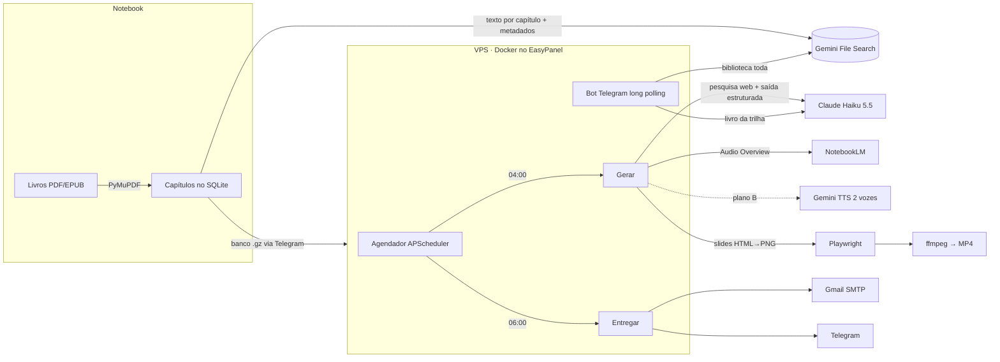

# Estudo IA 📚🤖

> Um sistema que transforma uma biblioteca pessoal de livros sobre IA e liderança num **pacote de estudo diário de 90 minutos**: newsletter, questões, podcast e vídeo-aula, entregues às 6h da manhã por e-mail e Telegram. Além disso, há um tutor no Telegram que responde perguntas sobre os livros, com citação.

Projeto pessoal construído durante a minha transição de carreira para tecnologia (MBA em AI Leadership, FIAP). Ele é, ao mesmo tempo, a ferramenta com que eu estudo e um laboratório de engenharia de sistemas com IA generativa.

---

## O problema

Eu tinha 27 livros técnicos (RAG, agentes, LLMOps, estratégia de IA, produto) e pouco tempo. Ler sem método não fixava o conteúdo, e eu não tinha um jeito de **revisar**, **praticar** e **tirar dúvidas** sem parar o estudo.

Eu queria:
- uma trilha que dividisse cada livro em sessões de ~90 minutos;
- material **original e leve**, com analogias, questões e revisão espaçada, e não um resumo do livro;
- formatos para momentos diferentes: ler (PDF), ouvir (podcast no trânsito) e assistir (vídeo);
- um tutor para perguntas a qualquer hora;
- tudo funcionando **sozinho**, sem depender do meu notebook ligado.

## O que o sistema entrega

| Todo dia às 06:00 | Sob demanda, no Telegram |
|---|---|
| 📧 Newsletter em HTML no e-mail | 💬 Perguntas livres sobre os livros |
| 📄 PDF com 10 questões de múltipla escolha, 5 abertas e gabarito comentado | 📖 `/livro`, `/proximo`, `/status`, `/pular` para a trilha |
| 🇺🇸 Inglês técnico do dia (5 termos) | 🌐 `/geral` para buscar na biblioteca inteira |
| 🔁 Revisão espaçada (questões de 1, 3 e 7 sessões atrás) | 📦 `/pacote` para gerar o pacote na hora |
| 🎧 Podcast de até 25 min (dois apresentadores) | |
| 🎬 Vídeo-aula de até 15 min (slides narrados) | |

## Arquitetura



**Fluxo do dia**
1. **04:00, geração.** O planejador escolhe a próxima sessão. O Claude pesquisa na web os conceitos centrais e escreve newsletter, questões e roteiros em JSON validado. O NotebookLM gera o podcast, e, se falhar, o Claude escreve um diálogo que o Gemini TTS narra com duas vozes. Os slides são renderizados e narrados, e o ffmpeg monta o vídeo.
2. **06:00, entrega.** O e-mail sai com a newsletter e o PDF, e o Telegram recebe PDF, MP3 e MP4. A sessão é marcada como feita e a trilha avança.
3. **Falhas não derrubam o resto.** Se o vídeo falhar, o pacote chega sem ele e um alerta explica o motivo.

## Decisões técnicas (e por quê)

| Decisão | Motivo |
|---|---|
| **Modelo híbrido no tutor**: Claude lê o livro da trilha inteiro; Gemini File Search busca na biblioteca toda | Para o livro em estudo, ler o livro todo (1M de contexto, prompt caching) dá respostas melhores e em ~5 s. Para 27 livros (~3,5M tokens), RAG é o único caminho viável, e o File Search do Gemini é gerenciado e gratuito no meu uso. |
| **Claude Haiku 5.5** para gerar conteúdo | Qualidade suficiente para material didático a ~US$ 0,07 por pacote, incluindo a pesquisa web. |
| **Saída estruturada (Pydantic)** em vez de texto livre | O pacote vira dados (`ConteudoPacote`, `MidiaPacote`) que alimentam templates, PDF, slides e revisão espaçada. As quantidades (10 questões, 5 termos) são conferidas no código. |
| **Citações automáticas desligadas** | Com elas ligadas, o modelo copiava trechos literais do livro. A regra do projeto é explicação original, com citação de no máximo 2 frases. |
| **URLs das fontes vêm da busca real**, nunca do texto do modelo | Para eliminar links inventados na seção "Para ir além". |
| **NotebookLM com plano B obrigatório** | A biblioteca `notebooklm-py` não é oficial e pode quebrar sem aviso. O fallback com Gemini TTS garante que o podcast sempre chegue (*degradação graciosa*). |
| **Telegram em long polling** | Dispensa domínio, HTTPS e porta aberta: o container não expõe nada na internet. |
| **Playwright para PDF e slides** (em vez de WeasyPrint) | Uma ferramenta para as duas coisas, sem a dependência de GTK no Windows. |
| **Vídeo de imagens paradas** (H.264 `stillimage`, 2 fps) | 11 minutos de vídeo em ~7 MB, bem abaixo do limite de 50 MB do Telegram. |
| **Livros fora do git e da VPS** | Direitos autorais. A VPS recebe só o banco com o texto extraído, enviado pelo próprio bot (`/importar`). |
| **Limites de 1,2 GB e 1,5 CPU** no container | A VPS hospeda outros serviços em produção; se o Estudo IA exagerar, só ele sofre. |

## Stack

Python 3.12 · `uv` · `anthropic` (Claude Haiku 5.5, busca web, saída estruturada) · `google-genai` (File Search, TTS) · `notebooklm-py` · `python-telegram-bot` · PyMuPDF · SQLModel/SQLite · Jinja2 · Playwright · ffmpeg · APScheduler · pytest · Docker · EasyPanel

## Lições aprendidas

O que mais ensinou foram as integrações quebrando de jeitos diferentes do esperado:

1. **APIs travam em silêncio.** O Gemini TTS do plano gratuito às vezes simplesmente não responde, e o timeout da própria biblioteca não valeu. A solução teve três camadas: tempo limite "duro" com thread, alternância entre dois modelos a cada tentativa e, como último recurso, narrar o trecho em duas metades. Também passei a salvar as narrações já feitas, para retomar de onde parou.
2. **Bibliotecas têm padrões que passam por cima da sua configuração.** O `python-telegram-bot` usa 20 s para upload e 5 s para download em cada chamada, ignorando o cliente. Um MP3 de 12 MB não sobe em 20 s. O erro só aparece com arquivos reais.
3. **Saída estruturada não garante quantidade nem completude.** O raciocínio interno do modelo também consome `max_tokens`, e a primeira resposta veio com o JSON cortado no meio. A correção foi usar streaming com limite alto e conferir as quantidades no código.
4. **"Funciona no meu notebook" esconde detalhes do sistema operacional.** No Windows: `sqlite3.connect` num `with` não fecha a conexão; o Smart App Control bloqueia executáveis não assinados; e o Chromium embutido salvava o login do Google sem um cookie obrigatório.
5. **Segredos vazam por caminhos inesperados.** A URL da API do Telegram contém o token, e o log padrão do `httpx` registraria a URL inteira. O logger foi silenciado e há um teste garantindo que segredos não aparecem na tela.
6. **Prompt é produto.** O primeiro pacote estava correto, mas era "apostila". Pedir questões sobre *conceitos* (e não sobre "o que o autor disse"), cenários práticos e analogias do dia a dia mudou completamente o valor do material.

## Como rodar

```bash
uv sync
cp .env.example .env              # preencha as chaves
uv run estudo-ia ingerir           # extrai os livros de biblioteca/ e indexa no File Search
uv run estudo-ia livros            # lista os livros e capítulos
uv run estudo-ia pacote --teste    # gera newsletter + PDF da próxima sessão
uv run estudo-ia diario            # gera tudo (texto, podcast, vídeo) e entrega
uv run estudo-ia bot               # liga só o bot
uv run estudo-ia servico           # bot + agendador (o que roda no container)
uv run pytest                      # 47 testes
```

Em produção, o [Dockerfile](Dockerfile) empacota Python, ffmpeg, Chromium e fontes. O volume `/data` guarda banco, pacotes e logs. Cada `git push` na `main` dispara um webhook que faz o EasyPanel reconstruir e reiniciar o serviço (deploy contínuo).

## Estrutura

```
src/estudo_ia/
├── ingestao/   extração por capítulo (PyMuPDF) + Gemini File Search
├── leitura/    Claude lendo o livro da trilha inteiro
├── bot/        Telegram: comandos, roteador híbrido, importação do banco
├── trilha/     planejador de sessões de ~90 min
├── pacote/     pesquisa web, geração estruturada, templates HTML/PDF
├── podcast/    NotebookLM + fallback Gemini TTS
├── video/      slides + narração + ffmpeg
├── entrega/    e-mail, Telegram e o pipeline do dia
└── agendador.py
```

---

*Os livros usados são adquiridos legalmente e não fazem parte do repositório. Todo o material gerado é explicação original produzida por IA.*
